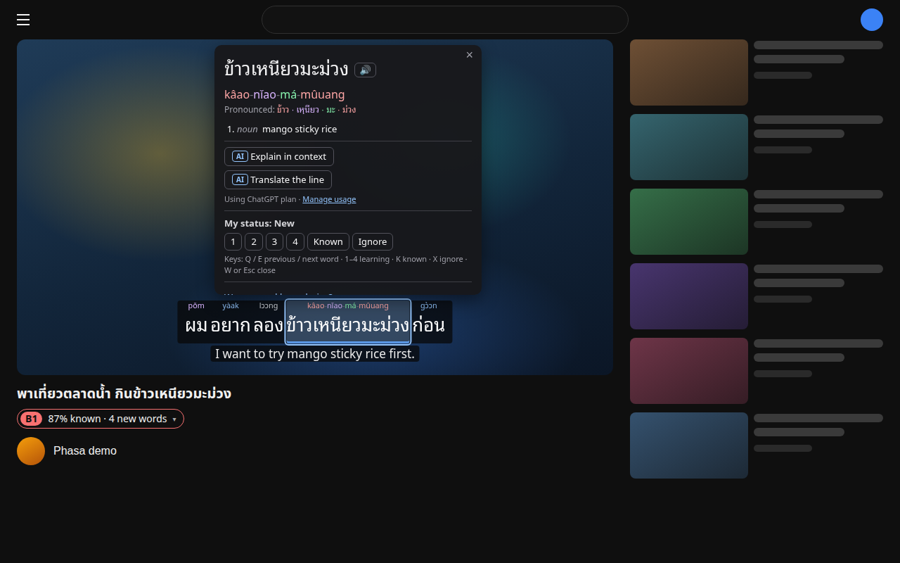
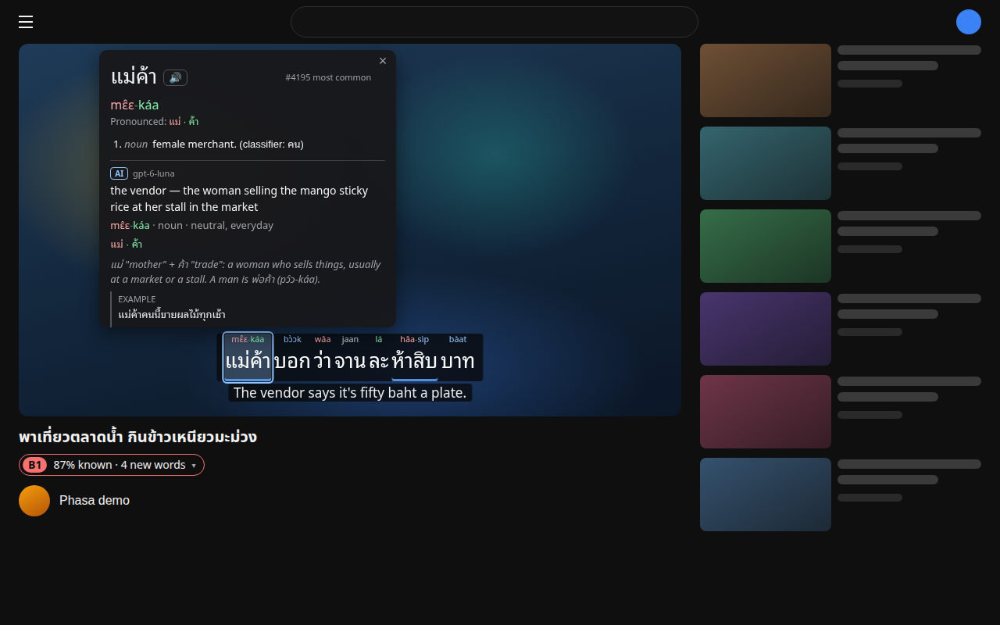
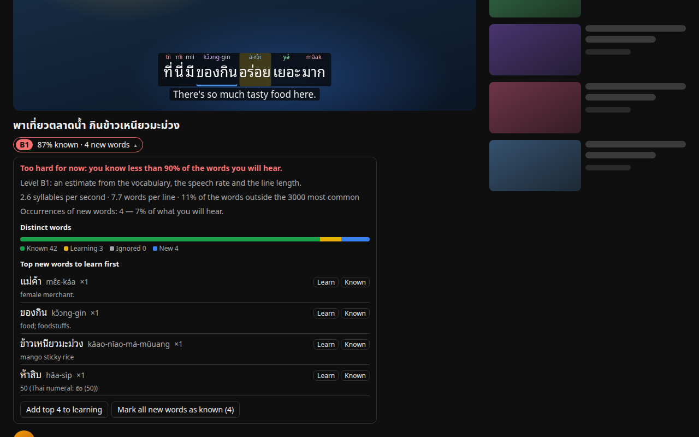
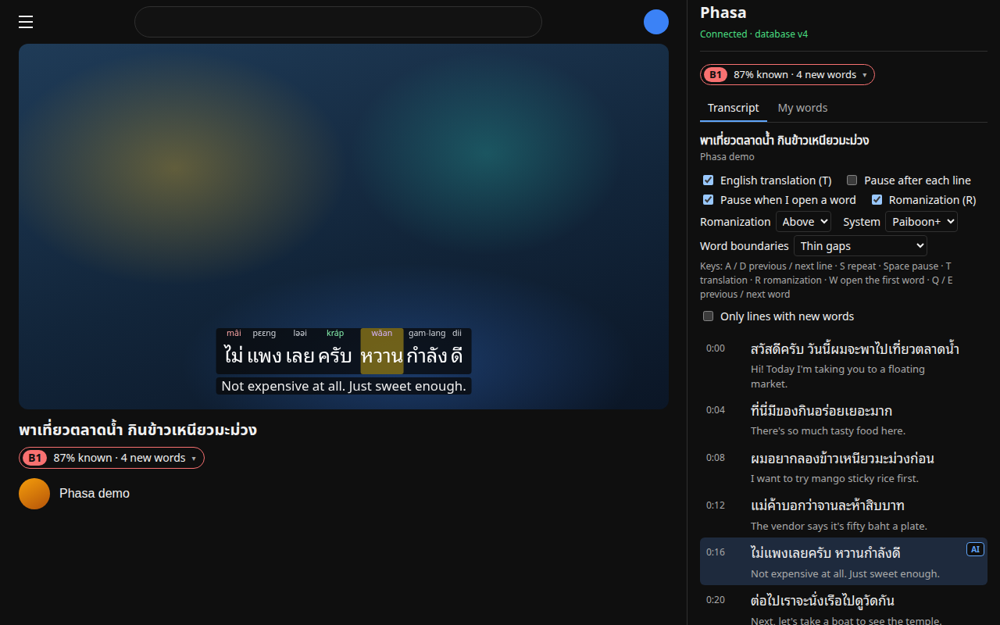
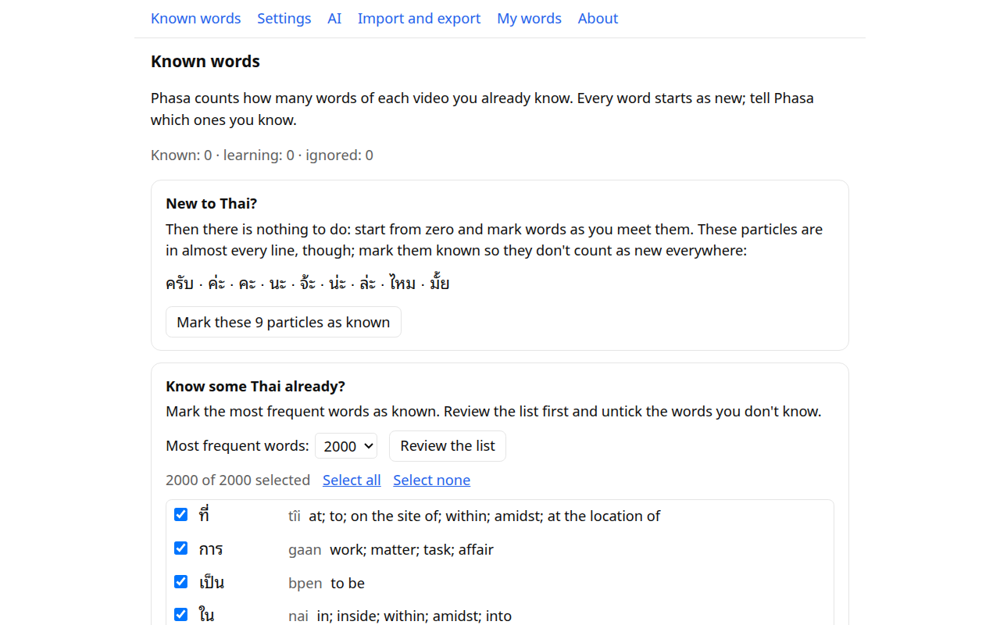

# Phasa

**Learn Thai from YouTube videos with Thai subtitles.** Phasa is a free, open-source Chrome
extension: it shows a video's Thai subtitles as text you can click, with the meaning, romanization
and tones of every word, keeps track of the words you know, and tells you how hard a video will be
before you start. Optional AI explanations use your own ChatGPT plan.



## What it does

- **Subtitles you can read.** Thai and English lines over the player in a looped Thai font;
  romanization (Paiboon+ or RTGS) with tones in color and tone marks; thin gaps or underlines
  between words, since written Thai has no spaces.
- **Words in one click.** Meaning, part of speech, classifier, syllables with their tones,
  frequency and a Thai voice. Drag across words for a phrase; fix a wrong word boundary.
- **Your vocabulary.** Mark words learning (1–4), known or ignored; they keep their color in every
  video. Saved words keep the line they came from and open the video at that moment.
- **Know before you watch.** A badge under the title: level estimate, share of words you know,
  new words, and the most useful ones to learn first.
- **Side panel.** The full transcript next to the video, and your saved words.
- **Data.** Mark the most frequent words known to start, import a word list or an Anki deck; back
  up and restore everything; export words for Anki or as CSV.
- **AI, if you want it.** "Explain in context" and "Translate the line" with your ChatGPT Plus or
  Pro plan, or your own OpenAI API key.

It works on videos that have Thai subtitles, made by the uploader or generated by YouTube. Videos
without Thai subtitles are not supported.

| AI explanation in context                                                      | Video analysis                                                                     |
| ------------------------------------------------------------------------------ | ---------------------------------------------------------------------------------- |
|  |      |
| **Side panel**                                                                 | **Known-word onboarding**                                                          |
|        |  |

## Install

- **Chrome Web Store:** under review; the link follows here once it is published.
- **From a release:** download `phasa-<version>-chrome.zip` from
  [Releases](https://github.com/Nexcod/phasa/releases) and unzip it. In Chrome open
  `chrome://extensions`, turn on **Developer mode**, click **Load unpacked** and choose the unzipped
  folder. It doesn't update itself: unzip each new release into the same folder and click the
  reload button on `chrome://extensions`. Your words stay; a different folder would install a
  second, empty copy.
- **From source:** see [Development](#development).

Phasa needs desktop Chrome.

## Use it

1. Open a YouTube video with Thai subtitles. Phasa's subtitles replace YouTube's, and the badge
   under the title shows how much of it you know.
2. Click a word for its popup; press **1–4**, **K** (known) or **X** (ignore) to save it.
3. Phasa's toolbar button shows the video and quick settings, opens the side panel and the
   options page. In the options, mark the words you already know, set up AI and change the look.

| Keys on a video               |                                    |
| ----------------------------- | ---------------------------------- |
| **A** / **D**                 | previous / next line               |
| **S**                         | repeat the line                    |
| **Space**                     | play / pause                       |
| **T** / **R**                 | English line / romanization on–off |
| **W**                         | open the line's first word         |
| **Q** / **E** (popup open)    | previous / next word               |
| **1–4**, **K**, **X** (popup) | learning, known, ignored           |
| **Esc**                       | close the popup                    |

## AI with your ChatGPT plan

AI is optional. Phasa uses OpenAI's
[Sign in with ChatGPT](https://developers.openai.com/siwc/token-sharing-open-source), which lets
open-source apps use a ChatGPT Plus or Pro plan without an API key. Your requests count toward your
plan's usage limits; no API key or extra payment is needed.

1. **Options → AI → Continue with ChatGPT.** OpenAI's sign-in opens in a new tab: choose your
   account, then agree to let "Phasa" use your ChatGPT plan. OpenAI shows Phasa as an unverified
   app: open-source apps register themselves with OpenAI at the first sign-in.
2. **The redirect.** OpenAI's sign-in returns to `http://127.0.0.1:1455/auth/callback`, a loopback
   address, as it does for desktop apps. An extension can't run a server there, so while you sign
   in, Phasa redirects that one address to its own page (a `declarativeNetRequest` rule that is
   removed afterwards). That page finishes the sign-in and says "Connected ✓".
3. **Tokens.** OpenAI's tokens are kept in the extension's own storage, which web pages can't
   read, and only Phasa's background service worker uses them. It renews them as needed, so you
   stay signed in.
4. **Asking.** "Explain in context" or "Translate the line" in a word's popup, or the AI button on
   a transcript line, sends the word, its line and the lines around it to OpenAI and streams the
   answer back. Answers are saved and show again without a new request. At the usage limit,
   **Manage usage** opens your ChatGPT usage settings. Pick the model in Options → AI.
5. **Signing out.** "Sign out" deletes the tokens and asks OpenAI to revoke them; "Forget account"
   also forgets the account, so the next sign-in starts from the beginning. You can revoke Phasa
   in your ChatGPT settings too.

**Your own OpenAI API key** works instead (paid per request on your API account), or, if you turn
that on, as a fallback when the plan can't answer, for example at its usage limit. Without AI,
everything else works.

## Privacy

Phasa has no server, no account, no analytics and no ads. Your words and settings stay in your
browser. Text goes to OpenAI only when you sign in and ask for an AI answer. Details:
[PRIVACY.md](PRIVACY.md).

## Project status

| Phase (docs/plan.md §12)    | Status                                                                                                                                                                                                                                                                                                                                                                                                                                                                                                                                                               |
| --------------------------- | -------------------------------------------------------------------------------------------------------------------------------------------------------------------------------------------------------------------------------------------------------------------------------------------------------------------------------------------------------------------------------------------------------------------------------------------------------------------------------------------------------------------------------------------------------------------- |
| 0 — spikes and decisions    | **Accepted 2026-10-16**: captions source (ADR 0002), Sign in with ChatGPT via a DNR redirect (ADR 0003), data sources (ADR 0004), segmentation baseline (ADR 0005) — see [docs/spikes.md](docs/spikes.md)                                                                                                                                                                                                                                                                                                                                                            |
| 1 — scaffold                | **Accepted 2026-10-16**: loads unpacked in Chrome, an empty overlay mounts on youtube.com watch pages, the toolbar button opens the side panel, unit + e2e tests and CI are green; the `dev` script builds and serves the dev extension                                                                                                                                                                                                                                                                                                                              |
| 2 — captions and rendering  | **Accepted 2026-10-28** after the [manual checklist](docs/manual-checklist.md) in Chrome and the local network e2e (ADR 0009): Thai + English subtitles over the player from the player's own PoToken (ADR 0007), cached per video; Noto Sans Thai Looped; side-panel transcript; hotkeys A/D/S/Space/T; auto-pause. Live run: Thai ready 0.5–1.7 s after the player loads (docs/spikes.md §1 run 3)                                                                                                                                                                 |
| 3 — words                   | **Accepted 2026-11-01** after the [manual checklist](docs/manual-checklist.md) in Chrome and the local network e2e: Wiktionary dictionary + TNC ranks (ADR 0010), tokenizer (F1 0.963 on 249 real cues from 13 videos, 0.966 overall; native-speaker review of the gold set after phase 7), word popup (15 ms in e2e) with romanization, tones, TTS, statuses, phrases, boundary fixes; keys W/Q/E, 1–4/K/X; saved words with context in the side panel and options                                                                                                  |
| 4 — analysis and onboarding | **Accepted 2026-11-01** after the [manual checklist](docs/manual-checklist.md) in Chrome and the local network e2e: badge under the title and in the side panel — level estimate, share of known words, distinct new words (ADR 0011, 0012) — with details, top new words, add top 10 to learning, mark all as known; onboarding with particles, top-N review and TXT/CSV/Anki import. 20-minute video analyzed in 79 ms; level calibration on hand-rated videos after phase 7                                                                                       |
| 5 — AI                      | **Accepted 2026-11-02** after the [manual checklist](docs/manual-checklist.md) in Chrome and the local network e2e: Sign in with ChatGPT through the loopback redirect (ADR 0003) with refresh, sign-out and forget; credentials only in the service worker and the extension's IndexedDB (ADR 0014); "Explain in context" and "Translate the line" in word and phrase popups and on side-panel lines, streamed, validated and cached; usage-limit and error messages with "Manage usage"; own OpenAI API key as an alternative or opt-in fallback                   |
| 6 — data and polish         | **Accepted 2026-11-13** after the [manual checklist](docs/manual-checklist.md) in Chrome and the local network e2e: JSON backup and merging restore without credentials, tested as export → fresh install → import (ADR 0016); word lists for Anki (TSV with headers and tags) and CSV; settings for theme, Thai font, subtitle size and tone colors, applied live; toolbar popup with the video, quick settings and AI; About section; update notice in open tabs; captions cache limited to 100 videos. 20-minute video analyzed in 208 ms with 20 000 known words |
| 7 — release                 | **Implemented 2026-11-13, awaiting manual acceptance** ([checklist](docs/manual-checklist.md)): version 1.0.0; this README, [privacy policy](PRIVACY.md), icons, store screenshots and promo tiles generated from the build ([docs/store](docs/store/README.md)); store listing with permission justifications and privacy answers; license, data attribution and third-party notices in the zip; package check in CI; a version tag drafts a GitHub release with the zip (ADR 0017)                                                                                 |

**After phase 7**, with the owner's or a native speaker's input: native-speaker review of the
segmentation gold set ([guide](docs/segmentation-review/GUIDE.md)), level calibration on 30–50
hand-rated videos (`tests/fixtures/levels.csv`, ADR 0011), Volubilis as a second dictionary
(ADR 0010).

## Development

Requirements: Node ≥ 22.12 (see `.nvmrc`) and npm ≥ 11.19 for the install-script and release-age
policy in `.npmrc` ([ADR 0008](docs/decisions/0008-npm.md)).

```sh
npm install
npm run dev        # dev build with HMR into .output/chrome-mv3-dev (keep it running: its pages load from the dev server)
npm run build      # production build into .output/chrome-mv3
npm run zip        # store-ready zip; then npm run package:check (docs/store/README.md)
```

Load the build: `chrome://extensions` → Developer mode → **Load unpacked** → `.output/chrome-mv3`
(or `-dev`). Open a YouTube watch page with Thai captions; the toolbar button opens Phasa's popup,
which opens the side panel.
Live captions can't be tested under automation; [docs/manual-checklist.md](docs/manual-checklist.md)
lists the checks done by hand.

| Command                                           | What it does                                                                                                                |
| ------------------------------------------------- | --------------------------------------------------------------------------------------------------------------------------- |
| `npm run lint` / `npm run format`                 | ESLint (type-aware) / Prettier                                                                                              |
| `npm run typecheck`                               | `tsc --noEmit`                                                                                                              |
| `npm test`                                        | Vitest unit tests                                                                                                           |
| `npm run test:e2e`                                | Build (with dev-only test pages) + Playwright e2e against a fake youtube.com (first run: `npx playwright install chromium`) |
| `npm run test:e2e:network`                        | e2e against real youtube.com (`@network`); run locally, YouTube blocks CI runners (ADR 0009)                                |
| `npm run spike:seg [file]`                        | Segmentation baseline: `Intl.Segmenter` vs a gold file                                                                      |
| `npm run seg:eval`                                | The tokenizer with the built dictionary vs `tests/fixtures/segmentation.tsv`, with mismatches                               |
| `npm run seg:review:export` / `seg:review:import` | Spreadsheet for a native-speaker check of the gold set and applying the result ([guide](docs/segmentation-review/GUIDE.md)) |
| `npm run data:freq` / `data:dict`                 | Rebuild `data/build/` from the sources (cached in `data/raw/`; `-- --refresh` downloads again; ADR 0010)                    |
| `npm run fonts:fetch`                             | Re-download the bundled Thai fonts into `public/fonts/` (committed; see its README)                                         |
| `npm run icons`                                   | Draw the icons and the store's promo tiles (`public/icon/`, `docs/store/`)                                                  |
| `npm run store:screenshots`                       | Production build + the five store screenshots in `docs/store/screenshots/`                                                  |
| `npm run package:check`                           | After `npm run zip`: version, permissions, icons and license files of the store zip (ADR 0017)                              |

## Layout

```
entrypoints/   background (SW), youtube.content (overlay, title badge), youtube-main.content
               (MAIN world), sidepanel, options, popup (toolbar), auth-callback (Sign in with
               ChatGPT redirect), fonts-test (dev/test builds only)
src/           captions (parsers, processing, track choice; main/ = MAIN-world fetcher),
               content (overlay state, playback sync, hotkeys, panel link, word data),
               messaging (typed Port protocols), db (Dexie schema + migrations), background
               (SW handlers, tokenizing and lookups, analysis, onboarding), settings, thai
               (normalization, tokenizer, segmentation convention, romanization), dictionary
               (kaikki conversion, store, pronunciation, frequency list), analysis (coverage,
               level, top new words), vocab (saved words, contexts, segmentation rules, bulk
               changes, word-list import), backup (backup file, merging restore, Anki/CSV word
               lists), auth (Sign in with ChatGPT, credentials), ai (Responses API client,
               providers, prompts, cache), i18n, ui (shared components, appearance settings)
data/build/    built dictionary and frequency list (committed, CC BY-SA 4.0, ATTRIBUTION.md)
tests/         unit (Vitest), e2e (Playwright), store (store screenshots), fixtures
spikes/        phase-0 experiment kits (not shipped)
docs/          plan.md, spikes.md, decisions/ (ADRs), store/ (Chrome Web Store listing and images)
```

Architecture rules (also in `AGENTS.md`): IndexedDB only in extension-origin contexts; content
scripts talk to the service worker through `src/messaging`; OpenAI tokens never leave the service
worker. The first two are enforced by ESLint and a runtime guard; for the third, content scripts
can't import `src/auth` or `src/ai` (ESLint), account methods answer extension pages only, and the
credentials live in the extension's IndexedDB, out of content scripts' reach (ADR 0014). The e2e
tests use a fake OpenAI and never reach the real one.

## License

Copyright (C) 2026 Phasa contributors.

Phasa is free software: you can redistribute it and/or modify it under the terms of the
[GNU Affero General Public License](LICENSE) as published by the Free Software Foundation, either
version 3 of the License, or (at your option) any later version (`AGPL-3.0-or-later`). It is
distributed WITHOUT ANY WARRANTY; see the license for details. This covers the extension and any
future server code in this repository; see [ADR 0006](docs/decisions/0006-license.md).

Dictionary and frequency data in `data/build/` are licensed separately (CC BY-SA 4.0 and others),
see [data/build/ATTRIBUTION.md](data/build/ATTRIBUTION.md). The bundled npm packages keep their
own licenses; the extension package lists them with their texts in `THIRD_PARTY_NOTICES.txt`
(ADR 0017). Contributions: [CONTRIBUTING.md](CONTRIBUTING.md).

Phasa is not affiliated with YouTube or OpenAI.
