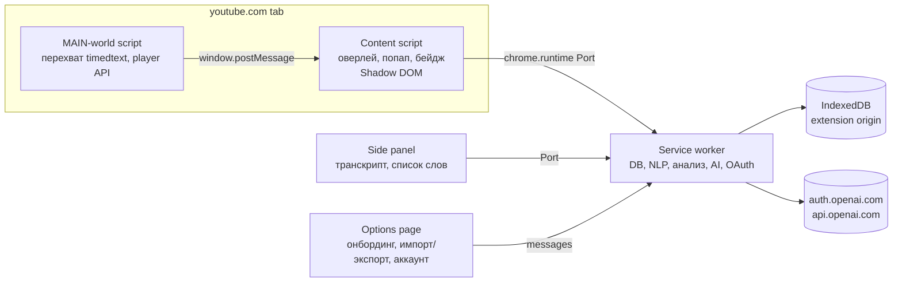

# Phasa — Chrome-расширение для изучения тайского по YouTube

> Рабочее название: **Phasa** (ภาษา, «язык»). Слова «YouTube» и «Tube» в названии не использовать: это нарушает правила Chrome Web Store о товарных знаках. В описании допустимо «for YouTube».
>
> Документ — план реализации для Claude Code. Работать по фазам (раздел 12). Каждая фаза заканчивается проверяемыми критериями приёмки. Технические факты про YouTube и OpenAI сверены на **16.10.2026**. Оба API быстро меняются, поэтому фаза 0 начинается со spike-проверок.

---

## 1. Цели, не-цели и принятые решения

### Цель
Расширение для Chrome (Manifest V3), которое превращает любое YouTube-видео с тайскими субтитрами в учебный материал:
- полноценный рендер и разбор тайского текста;
- клик или выделение слова → перевод, романизация, тоны, контекст;
- сохранение слов с контекстом (предложение, видео, таймкод);
- сразу при открытии видео: оценка сложности и подсчёт «знаю / новые слова»;
- AI-объяснения через **существующую подписку ChatGPT** (Sign in with ChatGPT).

### Принятые решения
| Вопрос | Решение |
|---|---|
| Распространение | **Open-source**, бесплатно: публичный GitHub + Chrome Web Store |
| Язык переводов и UI | **Английский**. i18n-ключи заложить сразу (`_locales/en`), другие языки не делать |
| Хранение данных | **Локально** (IndexedDB) + экспорт/импорт (JSON, CSV, Anki). Без своего сервера |
| Видео без тайских субтитров | **Не поддерживаются.** Показывать понятный статус «No Thai subtitles» |
| AI | Основной путь — Sign in with ChatGPT (план Plus/Pro). Запасной — свой OpenAI API key. Без AI всё, кроме AI-объяснений, работает на локальном словаре |

### Не-цели (v1)
- Другие языки, кроме тайского.
- Распознавание речи (Whisper) для видео без субтитров.
- Облачная синхронизация, аккаунты, свой бэкенд.
- Мобильные браузеры.

---

## 2. Функциональность

Ориентир — функции Language Reactor, Trancy, LingQ и Migaku, но с фокусом на особенности тайского.

### 2.1 MVP
**Субтитры и плеер**
- Свой оверлей субтитров поверх плеера. Нативные субтитры YouTube скрыть.
- Двойные субтитры: тайский + английский. Источник английского: ручная EN-дорожка → машинный перевод YouTube (`tlang=en`, бесплатно) → AI по запросу.
- Режим границ слов в тайском тексте: `none` / `thin gaps` / `alternating underline`. В тайском нет пробелов между словами, а новичкам границы нужны.
- Переключатель романизации над или под строкой.
- Подсветка слов по статусу: new / learning (1–4) / known / ignored.
- Горячие клавиши: `A`/`D` — предыдущая/следующая реплика, `S` — повтор реплики, `Space` — пауза, `R` — показать/скрыть романизацию, `T` — показать/скрыть перевод.
- Автопауза в конце каждой реплики (опционально).
- Боковая панель (`chrome.sidePanel`): полный транскрипт, клик → перемотка, подсветка текущей строки, фильтр «строки с новыми словами».

**Работа со словами**
- Наведение или клик по слову → попап: тайское слово, романизация с цветом тонов, разбивка на слоги, словарные значения, часть речи, классификатор (для существительных), кнопка TTS (`speechSynthesis`, голос `th-TH`).
- Выделение нескольких слов мышью → фраза; сохраняется как отдельная единица.
- Статусы слова: `1–4` (learning), `known`, `ignored`. Клавиши `1–5`, `K`, `X` в попапе.
- Сохранение с контекстом: предложение, перевод предложения, `videoId`, название видео, таймкод. Клик по контексту → открыть видео на этом месте.
- Кнопка «Explain in context (AI)»: значение именно в этом предложении, регистр и вежливость, частицы, пример.

**Анализ видео при загрузке**
- Бейдж под плеером и в боковой панели: `Level B1 · 87% known · 142 new (61 unique)`.
- Список «Top new words to learn first»: новые слова, отсортированные по частоте в видео × общей частоте.
- Без AI и без сети, только локальные данные. Цель — < 500 мс для 20-минутного видео.

**Онбординг известных слов**
- «I'm a beginner» → пустой словарь.
- «Mark top-N frequent words as known» (N = 100 / 500 / 1000 / 2000 / 5000), с возможностью просмотреть и снять отметки.
- Импорт списка: CSV/TXT по одному слову в строке, экспорт Anki-колоды (TSV).
- Массовая отметка «Mark all remaining words in this video as known» (как в LingQ), с подтверждением.

**Данные**
- Экспорт и импорт всего словаря в JSON (бэкап).
- Экспорт в Anki: TSV с полями Thai, Romanization, Meaning, Sentence, Translation, Video link. `.apkg` — позже.

### 2.2 Фаза 2 (после MVP)
- Повторение слов (SRS, библиотека `ts-fsrs`) прямо в расширении, с контекстом реплики.
- Бейджи сложности на миниатюрах видео в поиске, на главной и в рекомендациях — только для уже проанализированных видео.
- AI-разбор всей реплики: дословный перевод + грамматика.
- AI-починка сегментации и пунктуации автосубтитров.
- Статистика: слов выучено за неделю, минуты просмотра, рост покрытия.

---

## 3. Архитектура

### 3.1 Стек
- **WXT** (фреймворк для MV3-расширений, Vite) + **TypeScript** (strict).
- **React** для UI попапа, оверлея, боковой панели и настроек. Все стили внутри Shadow DOM.
- **Dexie** (IndexedDB).
- **Vitest** — unit-тесты, **Playwright** — e2e с загруженным расширением.
- **jose** — проверка ID-токена OpenAI (JWKS).
- **ts-fsrs** — SRS (фаза 2).
- ESLint + Prettier, pnpm.

### 3.2 Компоненты и границы



**Ключевые правила:**
1. **IndexedDB живёт только в origin расширения** (service worker, side panel, options). Content script работает в origin `youtube.com`, и его IndexedDB — это база YouTube. Поэтому content script никогда не открывает DB напрямую, только через сообщения в SW.
2. **Токены OpenAI никогда не попадают в content script или MAIN world.** Все AI-запросы идут из SW.
3. MAIN-world скрипт минимален: перехватывает сетевые запросы плеера и вызывает player API. Никакой логики и никаких данных пользователя.
4. Обмен content script ↔ SW — через долгоживущий `chrome.runtime.Port` с типизированным протоколом (discriminated unions). Активный Port заодно продлевает жизнь SW во время стриминга AI-ответа.
5. Тяжёлая обработка (токенизация, анализ) — в SW. Если окажется медленной — вынести в offscreen document или Web Worker.

### 3.3 Структура репозитория
```
phasa/
├─ entrypoints/
│  ├─ background.ts            # service worker: роутер сообщений
│  ├─ youtube.content/         # content script (ISOLATED world) + React UI
│  ├─ youtube-main.content.ts  # MAIN world, run_at: document_start
│  ├─ sidepanel/               # React
│  ├─ options/                 # React: onboarding, import/export, account
│  └─ auth-callback/           # страница приёма OAuth-редиректа (если нужна, см. 8.3)
├─ src/
│  ├─ captions/      # получение и парсинг дорожек, кеш
│  ├─ thai/          # нормализация, сегментация, романизация, тоны
│  ├─ dictionary/    # загрузка и поиск по словарю, частотность
│  ├─ analysis/      # покрытие, сложность, топ новых слов
│  ├─ vocab/         # статусы, контексты, импорт/экспорт
│  ├─ ai/            # провайдеры, промпты, схемы, кеш
│  ├─ auth/          # Sign in with ChatGPT (OAuth + PKCE)
│  ├─ db/            # Dexie schema, миграции
│  ├─ messaging/     # типизированный протокол
│  └─ ui/            # общие компоненты, шрифты, тема
├─ data/
│  ├─ raw/           # исходники словарей (в .gitignore, скачиваются скриптом)
│  └─ build/         # собранные компактные JSON (+ ATTRIBUTION.md)
├─ scripts/          # build-dictionary.ts, build-frequency.ts
├─ tests/
│  ├─ fixtures/      # json3 субтитры, тайские предложения с эталонной сегментацией
│  └─ e2e/
└─ docs/             # spikes.md, decisions/ (ADR)
```

---

## 4. Получение субтитров YouTube

**Главный технический риск.** С 2026 года эндпоинт `/api/timedtext` закрыт PoToken'ом. Это криптографический токен, который генерирует JS плеера и добавляет параметром `&pot=`. Прямой запрос без него возвращает пустой 200-ответ, даже с куками пользователя. Поэтому субтитры берём **из запросов самого плеера**.

### 4.1 Алгоритм
1. **Детект видео.** YouTube — SPA, поэтому слушать событие `yt-navigate-finish`, плюс fallback на `popstate` и наблюдение за `?v=`. Обрабатывать смену видео без перезагрузки и с отменой предыдущего анализа.
2. **Список дорожек.** В MAIN world: `document.getElementById('movie_player').getPlayerResponse()` → `captions.playerCaptionsTracklistRenderer.captionTracks`. Каждая дорожка: `languageCode`, `kind` (`asr` = автосубтитры), `vssId`, `baseUrl`.
3. **Выбор тайской дорожки:** ручная `th` → автоматическая `th` (`kind: 'asr'`) → нет дорожки → статус «No Thai subtitles», бейдж серый, остальной UI выключен.
4. **Перехват.** MAIN-world скрипт с `document_start` патчит `window.fetch` и `XMLHttpRequest.prototype.open/send`. Ловит URL с `/api/timedtext`, сохраняет полный URL (с `pot`) и тело ответа и передаёт их в content script через `postMessage` с проверкой `source` и nonce.
5. **Принудительная загрузка.** Если пользователь не включал субтитры, плеер их не запрашивает. Нужно программно включить тайскую дорожку через player API (`loadModule('captions')`, `setOption('captions', 'track', {languageCode: 'th'})`), поймать запрос, затем скрыть нативные субтитры через CSS (`.ytp-caption-window-container { display:none }`), не выключая их в плеере.
6. **Формат.** Если удаётся — перезапросить тот же URL с `fmt=json3`, сохранив `pot`. json3 удобнее XML. Если подмена параметров ломает ответ — парсить тот формат, который запросил плеер (поддержать json3, srv3/XML, VTT).
7. **Английская дорожка.** Попробовать тот же URL с `tlang=en` (машинный перевод YouTube) или ручную EN-дорожку. Проверить в spike, переносится ли `pot` между дорожками одного видео.
8. **Fallback:** панель транскрипта (InnerTube `get_transcript` / engagement panel). Изолировать за интерфейсом `CaptionSource`, чтобы источники можно было менять без правок остального кода.
9. **Кеш** в IndexedDB по `videoId + vssId`. Повторное открытие видео — мгновенно.

### 4.2 Постобработка тайских субтитров
- Автосубтитры (`asr`) часто без пунктуации и с разбиением на реплики по паузам, а не по предложениям. Склеивать короткие реплики (< 1 с, < 3 слов) с соседними. Пробелы внутри тайской строки считать границами фраз.
- Удалить `[เพลง]`, `[ดนตรี]`, `[หัวเราะ]` и подобные метки (список + regex по `[...]`).
- В модели данных пометить, ручные субтитры или автоматические. В UI показывать «auto-generated captions — may contain errors».

### 4.3 Критерии
- На 10 тестовых видео (5 с ручными, 5 с автосубтитрами — список в `tests/e2e/videos.ts`) субтитры извлекаются за < 3 с после загрузки плеера.
- Переход между видео через рекомендации работает без перезагрузки страницы.
- Работает в обычном режиме, в театральном режиме и на весь экран (оверлей перемонтируется в fullscreen-контейнер).

---

## 5. Тайский текст: рендер, нормализация, сегментация

### 5.1 Шрифты и рендер
- Встроить в расширение **Noto Sans Thai Looped** — шрифт с петельками, его легче читать начинающим. Запасной — **Noto Sans Thai**. Оба под OFL. Файлы `woff2` лежат в `public/fonts/`, объявлены в `web_accessible_resources` для `*://*.youtube.com/*`.
- **Подвох Shadow DOM:** `@font-face`, объявленный внутри shadow root, в Chrome не загружается. Поэтому `@font-face` инжектить в `document.head` (через `chrome.runtime.getURL`), а `font-family` использовать уже внутри shadow root.
- `line-height` ≥ 1.7 для тайских строк. Иначе надстрочные знаки (ไม้เอก, ไม้โท, สระอิ/อี/อึ/อือ) и подстрочные (สระอุ/อู) обрезаются в стеках вроде `น้ำ`, `ที่`, `ปู่`.
- Не использовать `letter-spacing`, `text-transform` и `font-synthesis`, ломающие шейпинг.
- Каждое слово — отдельный `<span>`. Границы span'ов **обязаны** совпадать с границами графемных кластеров. Сегментатор это гарантирует, а любой свой код слияния или разрезания работает только по границам `Intl.Segmenter(..., {granularity: 'grapheme'})`.
- Цвета тонов (единые во всём UI, настраиваемые): mid — серый, low — синий, falling — красный, high — зелёный, rising — фиолетовый.
- Тест-страница `fonts-test.html` (в dev-сборке) со сложными стеками: `น้ำ ที่ ปู่ ฟ้า ญี่ปุ่น ฎีกา ฐาน ฤดู ฦ ๆ ฯ ๑๒๓`. Сверять скриншоты при изменениях стилей.

### 5.2 Нормализация
- Unicode NFC.
- Удалить zero-width символы: U+200B, U+200C, U+200D, U+FEFF. Они часто встречаются в тайских субтитрах как скрытые границы слов. Перед удалением **сохранить их позиции как подсказки границ** для сегментатора.
- Исправить частые ошибки набора: `ํ` + `า` → `ำ`; `เ` + `เ` → `แ`; двойные тонмарки.
- Тайские цифры (๐–๙) ↔ арабские — для поиска; в отображении оставить как есть.
- Сохранять смещения (offset map) между исходной и нормализованной строкой, чтобы подсветка совпадала с оригиналом.

### 5.3 Сегментация на слова
Интерфейс:
```ts
interface ThaiTokenizer {
  tokenize(text: string): Token[];
}
type Token = { text: string; start: number; end: number; kind: 'thai' | 'latin' | 'number' | 'punct' | 'space' | 'repeat' };
```
- **Базовый вариант:** `Intl.Segmenter('th', { granularity: 'word' })`. Встроен в Chrome (словарь ICU), без зависимостей, быстрый.
- **Поверх базового — коррекция словарём:**
  - склейка соседних токенов, если их конкатенация есть в словаре приложения или в пользовательском списке фраз (жадно, максимальная длина, ограничение 4 токена). Пример: `โรง` + `เรียน` → `โรงเรียน`, если ICU разбил;
  - пользовательские правила «склеить» и «разрезать» — пользователь вручную правит границу, правило сохраняется глобально;
  - `ๆ` (ไม้ยมก) — токен `repeat`, привязывается к предыдущему слову (`เร็ว ๆ` = одна единица для статистики);
  - `ฯ` и `ฯลฯ` — сокращения, отдельные токены.
- **AI-коррекция (фаза 2):** для одной реплики по запросу пользователя.
- **Оценка качества:** эталонный набор из ≥ 200 предложений с ручной сегментацией в `tests/fixtures/segmentation.tsv`, собрать из реальных субтитров. Метрика — word-boundary F1. Порог для MVP: ≥ 0.90. Тест падает при регрессии.

### 5.4 Что считать «словом» для статистики
- Тайский язык изолирующий, лемматизация не нужна: **единица = нормализованная форма токена**.
- Исключать из подсчётов: `punct`, `space`, `number`, `latin` (английские вставки), имена собственные (если словарь помечает их как proper noun), метки `[เพลง]`.
- Частицы и служебные слова (`ครับ`, `ค่ะ`, `นะ`, `จ้ะ`, `คะ`, `น่ะ`, `ล่ะ`, `ไหม`, `มั้ย`) участвуют в статистике обычным образом. В онбординге для начинающих предлагать отметить их как known одной кнопкой.
- Варианты написания (`มั้ย` / `ไหม`, `ป่าว` / `เปล่า`) — таблица `variants`, статус общий.

### 5.5 Романизация и тоны
Тайская орфография не даёт надёжно вывести произношение правилами: неявные гласные, нечитаемые буквы (การันต์), исключения. Поэтому:
1. **Источник №1 — словарь** (поле произношения из Wiktionary, см. 6): слоги, тоны, романизация.
2. **Источник №2 — правила** для слов не из словаря: rule-based транскрипция с классами согласных (high/mid/low), живыми и мёртвыми слогами и тонмарками. Пометка «approximate».
3. **Источник №3 — AI** по запросу. Результат кешируется и помечается «AI».
- Системы романизации: **Paiboon+** (по умолчанию, с тонами и долготой) и **RTGS**. Переключатель в настройках. IPA — опционально.
- Тоны выводить и цветом, и диакритикой романизации (Paiboon: `à á â ǎ`), не полагаясь только на цвет.

---

## 6. Словарь и частотные данные

Сборка на этапе build: `scripts/build-dictionary.ts` скачивает исходники в `data/raw/`, собирает компактный `data/build/dict.json` (или несколько чанков по первой букве) и `freq.json`. При первом запуске SW загружает их в IndexedDB.

| Данные | Кандидаты | Лицензия (проверить в фазе 0) |
|---|---|---|
| Тайско-английский словарь, произношение, слоги, POS, классификаторы | Wiktionary (выгрузка kaikki.org / wiktextract) | CC BY-SA 4.0 + GFDL |
| Дополнительный словарь | Volubilis Thai dictionary | уточнить |
| Дополнительный словарь | LEXiTRON (NECTEC) | уточнить, возможен запрет на редистрибуцию — тогда не использовать |
| Частотность | PyThaiNLP word frequency (TNC, TTC corpora); `wordfreq` (th) | уточнить для каждого |

- Лицензионно-зависимые данные держать в `data/build/` с `ATTRIBUTION.md`. Код под MIT, данные — под своими лицензиями (CC BY-SA требует указания авторства и share-alike для производных данных).
- Бюджет размера словаря в сборке: ≤ 20 МБ (сжатый JSON). Если больше — ленивая загрузка чанков.
- Схема записи:
```ts
type DictEntry = {
  thai: string;
  romanization?: { paiboon?: string; rtgs?: string; ipa?: string };
  syllables?: { text: string; tone: 'mid'|'low'|'falling'|'high'|'rising' }[];
  senses: { pos?: string; glosses: string[]; classifier?: string }[];
  freqRank?: number;    // 1 = самое частотное
  isProperNoun?: boolean;
  source: ('wiktionary'|'volubilis'|'lexitron'|'ai')[];
};
```

---

## 7. Анализ сложности и «знаю / новые»

### 7.1 Входные данные
Токены всех реплик тайской дорожки, статусы слов пользователя, частотный ранг, тайминги реплик.

### 7.2 Метрики
- `tokensTotal` — число учитываемых токенов (с повторами); `uniqueTotal` — уникальных.
- `knownTokenCoverage` = доля токенов со статусом `known` или `ignored`. **Главная метрика понимания.**
- `knownUnique`, `learningUnique`, `newUnique`.
- `newHighFreq` — новые слова из топ-3000 по частоте (стоит учить), `newRare` — остальные.
- `speechRate` — тайских слогов в секунду по таймингам реплик.
- `avgCueLength` — средняя длина реплики в словах.
- `freqProfile` — доля токенов вне топ-1000 / 3000 / 5000 / 10000.

### 7.3 Две оценки
1. **Personal comprehension** — по покрытию известными словами (пороги из исследований чтения на L2, Hu & Nation):
   - ≥ 98% — Comfortable
   - 95–98% — Challenging but OK
   - 90–95% — Hard
   - < 90% — Too hard
2. **Absolute level** (не зависит от пользователя, A1–C2): взвешенная комбинация `freqProfile`, `speechRate`, `avgCueLength`. Начальные веса — эвристика в `analysis/levels.ts`. Калибровать на 30–50 видео с ручной оценкой (уроки для начинающих → A1/A2, новости → B2/C1, сериалы → B2+). Таблица калибровки — `tests/fixtures/levels.csv`.

### 7.4 Отображение
- Бейдж под заголовком видео и наверху боковой панели: `B1 · 87% known · 142 new (61 unique)` + цвет по personal comprehension.
- Клик по бейджу → панель: распределение статусов, «Top new words to learn first» (score = частота в видео × log(1/freqRank)), кнопки «Mark all as known», «Add top 10 to learning».
- Пересчёт в реальном времени при смене статуса слова.

### 7.5 Критерии
- Анализ 20-минутного видео (≈ 3000 токенов) < 500 мс в SW на среднем ноутбуке.
- Unit-тесты на фикстурах с заранее известными числами.

---

## 8. AI: Sign in with ChatGPT

### 8.1 Что это и можно ли нам
Sign in with ChatGPT запущен OpenAI 29.09.2026 (DevDay). У него два независимых разрешения:
- **Identity** — имя, email, аватар.
- **ChatGPT plan usage** — запросы к Responses API расходуют лимит плана пользователя (Plus/Pro). API-ключ не нужен.

На старте plan usage доступен open-source проектам, личным локальным проектам и выбранным частным приложениям. Платным и удалённо хостящимся продуктам нужна заявка через interest form. **Наш случай — бесплатный open-source — подходит.** Если когда-нибудь появится монетизация, сначала подать заявку.

Документация (сверять перед реализацией, это preview):
- Обзор: https://developers.openai.com/siwc/token-sharing-open-source
- Регистрация и вход: https://developers.openai.com/siwc/token-sharing-open-source/sign-in
- Модели и инференс: https://developers.openai.com/siwc/token-sharing-open-source/models-and-inference
- Ограничения preview: https://developers.openai.com/siwc/token-sharing-open-source/preview-limitations
- Ошибки: https://developers.openai.com/siwc/token-sharing-open-source/errors-and-recovery
- Аккаунты и обновление токенов: https://developers.openai.com/siwc/token-sharing-open-source/profiles-and-sessions
- UI/UX и брендинг кнопки: https://developers.openai.com/siwc/ui-ux-guidelines
- Cookbook и DevKit (эталонная реализация, Electron): https://developers.openai.com/cookbook/articles/sign-in-with-chatgpt, https://github.com/openai/sign-in-with-chatgpt-devkit

### 8.2 OAuth-поток (по документации)
1. **Host ID:** один раз на установку сгенерировать `urn:uuid:<uuidv4>`, хранить в `chrome.storage.local`, отправлять как `ext_agent_host_id`.
2. Для каждой попытки входа: свежие `state`, `nonce`, PKCE verifier (S256).
3. Authorize: `https://auth.openai.com/api/accounts/authorize` с параметрами:
   - `client_id=dynamic_agent_client` (первая регистрация) или сохранённый выданный `client_id` (`oaiapp_...`) при повторном входе;
   - `agent_name_hint=Phasa` (только при первой регистрации);
   - `ext_agent_host_id`, `response_type=code`, `redirect_uri`;
   - `scope=openid profile email offline_access resource.invoke chatgpt.tokens.use.direct`;
   - `resource=https://api.openai.com/v1`, `state`, `nonce`, `code_challenge`, `code_challenge_method=S256`;
   - при повторном входе: `id_token_hint` и/или `login_hint`.
4. Callback: `code`, `state`, `client_id` (выданный). Проверить `state`. Обработать `error=access_denied`. **Сохранить выданный `client_id` до обмена кода.**
5. Обмен: `POST https://auth.openai.com/api/accounts/oauth/token` (form-encoded): `grant_type=authorization_code`, выданный `client_id`, `code`, `code_verifier`, тот же `redirect_uri`, тот же `resource`. Клиентский секрет не нужен.
6. Проверить ID-токен через JWKS (`jose`): подпись, `iss`, `aud` = выданный `client_id`, `exp`, `nonce`. Включать AI только если в выданных scope есть `chatgpt.tokens.use.direct`. Identity без этого scope AI не даёт.
7. Хранить в `chrome.storage.local`: email, `sub`, `client_id`, host id, `id_token`, `access_token`, `refresh_token`, scopes, expiry. Refresh token ротируется — при обновлении заменять всё атомарно.

### 8.3 Проблема: redirect только на loopback
Документация требует `redirect_uri` вида `http://127.0.0.1:<port>/auth/callback`. Разрешено менять только порт, `localhost` запрещён. Расширение Chrome **не может** поднять HTTP-сервер, а `chrome.identity.launchWebAuthFlow` использует `https://<id>.chromiumapp.org/`, который здесь не подходит.

**Вариант A (основной, проверить в spike):** перехват навигации, без сервера.
- Открыть authorize-URL в новой вкладке (`chrome.tabs.create`) с `redirect_uri=http://127.0.0.1:1455/auth/callback`.
- После согласия браузер навигирует на `http://127.0.0.1:1455/auth/callback?code=...`. Перехватить эту навигацию одним из способов:
  - **A1:** правило `declarativeNetRequest` (session rule) с `regexSubstitution`, редиректящее `^http://127\.0\.0\.1:1455/auth/callback\?(.*)$` на `chrome-extension://<id>/auth-callback.html?\1`. Нужны `declarativeNetRequestWithHostAccess`, host permission `http://127.0.0.1/*`, страница в `web_accessible_resources`;
  - **A2:** `chrome.webNavigation.onBeforeNavigate` / `chrome.tabs.onUpdated` — прочитать URL до или после ошибки соединения, закрыть вкладку.
- Предпочтительнее A1: пользователь видит страницу расширения «Connected ✓», а не ошибку соединения.
- **Риск:** OpenAI это прямо не описывает. Технически для OAuth-сервера это обычный redirect. Если OpenAI начнёт требовать реальный listener (не видно, как он мог бы это проверить) или изменит правила — нужен вариант B.

**Вариант B (запасной):** маленький компаньон через Native Messaging (Go или Node SEA, один бинарник). Он поднимает настоящий loopback-listener и возвращает `code` расширению. Официально чистый путь, но требует отдельной установки.

**Вариант C (всегда доступен):** пользователь вставляет свой OpenAI API key в настройках. Тот же Responses API, тот же код провайдера.

### 8.4 Инференс
- Список моделей: `GET https://api.openai.com/v1/models` с Bearer-токеном → `models[]`, брать `visibility == "list"`, показывать `display_name`, отправлять `slug`. Модели не хардкодить. Пользователь выбирает модель в настройках; по умолчанию — первая быстрая модель из списка.
- Запрос: `POST https://api.openai.com/v1/responses`, `Authorization: Bearer <access_token>`.
- **Обязательные ограничения preview:**
  - всегда `store: false` и `stream: true`;
  - `input` — массив с полным контекстом; `previous_response_id` не использовать;
  - инструкции через `instructions` или developer-сообщения; `role: "system"` отклоняется;
  - **не отправлять**: `temperature`, `top_p`, `max_output_tokens`, `metadata`, `user`, `truncation`, `prompt`, `background`, `conversation` и др. (полный список — в preview limitations);
  - аудио и transcription API недоступны (поэтому Whisper через подписку невозможен — это соответствует решению «только видео с субтитрами»).
- Успех — только после события `response.completed`. Отдельно обрабатывать `response.failed`, `response.incomplete` и обрыв стрима.
- **Лимиты:** коды `subscription_sharing_usage_limit_exceeded` и `subscription_sharing_usage_unavailable` могут прийти уже посреди стрима. Показать сообщение с главной кнопкой «Manage usage» → `https://chatgpt.com/settings/usage`. Автоматически на API key не переключаться — только если пользователь сам включил fallback.
- **Структурированный вывод:** проверить в spike, работает ли `text.format: { type: "json_schema" }` на этом пути. Если нет — JSON в инструкциях + валидация через zod + один повтор при ошибке парсинга.
- В UI рядом с AI-функциями — пометка «Using ChatGPT plan» и кнопка «Manage usage». Кнопка входа — «Continue with ChatGPT» по UI/UX guidelines OpenAI.

### 8.5 Абстракция провайдера
```ts
interface AIProvider {
  id: 'chatgpt-plan' | 'openai-api-key';
  isReady(): Promise<boolean>;
  listModels(): Promise<{ slug: string; displayName: string }[]>;
  stream(req: { model: string; instructions: string; input: InputItem[] }, signal: AbortSignal): AsyncIterable<StreamEvent>;
}
```
Оба провайдера используют один клиент Responses API, разница только в источнике Bearer-токена.

### 8.6 AI-функции и промпты (`src/ai/prompts/`)
| Функция | Вход | Выход (JSON) |
|---|---|---|
| `explainWord` | слово, реплика, ±2 соседние реплики, название видео | meaning_in_context, pos, romanization_paiboon, syllables+tones, register/politeness, notes, example_th, example_en, classifier? |
| `translateCue` | реплика ± контекст | natural_en, literal_en, word_by_word[] |
| `explainGrammar` (фаза 2) | реплика | patterns[], particles[], explanation |
| `fixSegmentation` (фаза 2) | реплика | tokens[] (конкатенация обязана совпасть с входом — проверять в коде) |

- Кеш ответов в IndexedDB: ключ = sha256(функция + версия промпта + модель + вход).
- Пакетный AI-перевод всего видео — **только по явной кнопке** с предупреждением о расходе лимита. По умолчанию для второй строки субтитров используется бесплатный перевод YouTube.

### 8.7 Безопасность
- Токены — только в `chrome.storage.local` и только в SW. Не логировать токены, а в dev-режиме маскировать их в логах.
- `host_permissions` минимальные: `*://*.youtube.com/*`, `https://auth.openai.com/*`, `https://api.openai.com/*`, `http://127.0.0.1/*` (только для варианта A).
- Кнопка «Sign out»: удалить токены, сохранить `client_id` и host id (по документации для повторного входа). Отдельная кнопка «Forget account» удаляет всё.

---

## 9. Модель данных (Dexie)

```ts
words:        '++id, &thai, status, updatedAt, nextReviewAt'
              // status: 'new'|1|2|3|4|'known'|'ignored'; srs: {fsrs state}; note; createdAt
contexts:     '++id, wordId, videoId, [wordId+videoId]'
              // sentence, sentenceTranslation?, cueStartMs, cueEndMs, videoTitle, channel, createdAt
phrases:      '++id, &thai'   // мультисловные единицы, те же поля, что у words
videos:       '&videoId, analyzedAt'
              // title, channel, trackKind('manual'|'asr'), stats snapshot, durationSec
captions:     '&[videoId+vssId]'  // нормализованные реплики + токены, fetchedAt
segRules:     '++id, &key'        // пользовательские правила склейки/разреза
aiCache:      '&key, createdAt'
dict:         '&thai, freqRank'   // загруженный словарь
settings:     '&key'
```
- Версионирование схемы и миграции с первого дня.
- Экспорт и импорт JSON — полный дамп с `schemaVersion`. Импорт — слиянием по `thai` (выигрывает более «продвинутый» статус, контексты объединяются).

---

## 10. UI-детали

- Весь UI в content script — внутри Shadow DOM (изоляция от CSS YouTube).
- Оверлей позиционируется относительно `#movie_player`. Учитывать `ResizeObserver`, театральный режим, fullscreen (перенос в `document.fullscreenElement`), мини-плеер и скрытие контролов плеера.
- Попап слова: клик по слову ставит видео на паузу (настраивается). Закрытие — `Esc` или клик вне попапа; при закрытии воспроизведение продолжается, если пауза была автоматической.
- Тёмная тема: следовать атрибуту `dark` на `<html>` YouTube.
- Доступность: фокус с клавиатуры по словам (`Tab`/стрелки), `aria-label` с романизацией.
- Popup расширения (иконка в тулбаре): статус текущего видео, вход в ChatGPT, быстрые настройки, ссылка на options.

---

## 11. Разрешения manifest

```json
{
  "manifest_version": 3,
  "permissions": ["storage", "unlimitedStorage", "sidePanel", "declarativeNetRequestWithHostAccess", "tabs"],
  "host_permissions": [
    "*://*.youtube.com/*",
    "https://auth.openai.com/*",
    "https://api.openai.com/*",
    "http://127.0.0.1/*"
  ]
}
```
- `unlimitedStorage` — для словаря и кеша.
- Если в spike победит вариант A2 — вместо DNR добавить `webNavigation`.
- Для Chrome Web Store подготовить обоснование каждого разрешения и privacy policy: данные не покидают устройство, кроме AI-запросов к OpenAI по действию пользователя.

---

## 12. Фазы реализации

### Фаза 0 — Spikes и решения (сначала, до основной разработки)
Результаты записать в `docs/spikes.md`, решения — в `docs/decisions/*.md` (ADR).
1. **Captions spike:** MAIN-world перехват `timedtext` на 5 видео (ручные и `asr`). Проверить: можно ли переиспользовать `pot` для `fmt=json3`, для `tlang=en` и для другой дорожки; работает ли программное включение субтитров через player API.
2. **SIWC spike:** минимальное расширение, которое проходит вход по варианту A1 (затем A2), обменивает код, вызывает `/v1/models` и стримит ответ `/v1/responses` из SW. Проверить, работает ли `text.format: json_schema`. Если A не работает — оценить вариант B.
3. **Segmentation spike:** `Intl.Segmenter('th')` на 200 реальных репликах, F1 против ручной разметки, список типичных ошибок.
4. **Лицензии данных:** проверить Wiktionary/kaikki, Volubilis, LEXiTRON, частотные списки; выбрать набор, совместимый с open-source распространением.

**Приёмка:** все четыре пункта с выводами; выбран вариант OAuth; выбран источник субтитров; выбраны источники данных.

### Фаза 1 — Каркас
WXT + TS strict + React + Dexie + Vitest + Playwright + ESLint/Prettier; типизированный messaging; схема DB с миграциями; CI (GitHub Actions: lint, typecheck, unit tests, build zip).
**Приёмка:** расширение ставится как unpacked, на youtube.com появляется пустой оверлей, side panel открывается, `pnpm test` зелёный.

### Фаза 2 — Субтитры и рендер
Модуль `captions/` (раздел 4), нормализация (5.2), шрифты и рендер (5.1), синхронизация оверлея с `video.currentTime` (`requestVideoFrameCallback` или `timeupdate` + rAF), двойные субтитры, транскрипт в side panel, горячие клавиши, автопауза.
**Приёмка:** критерии 4.3; тест-страница шрифтов без обрезанных диакритик; задержка смены реплики < 100 мс.

### Фаза 3 — Слова
Токенизатор (5.3) с эталонным тестом, сборка словаря (6), попап слова, романизация и тоны (5.5), статусы, фразы, сохранение с контекстом, TTS, режимы границ слов.
**Приёмка:** F1 сегментации ≥ 0.90; клик по слову → попап < 100 мс; сохранённое слово с контекстом видно в side panel и в options.

### Фаза 4 — Анализ и онбординг
Модуль `analysis/` (раздел 7), бейдж, панель «Top new words», онбординг (top-N known, импорт CSV/TXT/Anki TSV), «Mark all as known».
**Приёмка:** критерии 7.5; после импорта 500 слов цифры покрытия меняются мгновенно.

### Фаза 5 — AI
Модуль `auth/` по итогам spike, провайдеры (8.5), `explainWord`, `translateCue`, кеш, обработка лимитов и ошибок, экран аккаунта в options, fallback на API key.
**Приёмка:** вход через ChatGPT Plus проходит end-to-end; повторный вход без consent-экрана; refresh токена после истечения работает; при исчерпании лимита — корректное сообщение с «Manage usage»; без входа всё, кроме AI, работает.

### Фаза 6 — Данные и полировка
Экспорт и импорт JSON, экспорт Anki TSV, настройки (романизация, цвета тонов, шрифт, размер), тёмная тема, обработка ошибок и пустых состояний, производительность.
**Приёмка:** полный цикл экспорт → чистая установка → импорт восстанавливает всё.

### Фаза 7 — Релиз
README (установка, скриншоты, как работает вход через ChatGPT), LICENSE (MIT для кода) + `ATTRIBUTION.md` для данных, privacy policy, иконки и скриншоты для Chrome Web Store, обоснования разрешений, ZIP-сборка в CI.

### После v1
SRS-повторение (`ts-fsrs`), бейджи на миниатюрах, AI-грамматика, AI-починка сегментации, статистика прогресса.

---

## 13. Тестирование
- **Unit (Vitest):** нормализация, токенизатор (эталонный TSV), романизация по правилам, анализ (фикстуры с известными числами), парсеры json3/srv3/VTT, OAuth-утилиты (PKCE, state, разбор callback), SSE-парсер Responses API, импорт/экспорт.
- **Контрактные фикстуры:** реальные ответы timedtext и Responses API (без токенов) в `tests/fixtures/`. Если YouTube изменит формат, первым сломается этот тест.
- **E2E (Playwright, persistent context с расширением):** открытие видео → оверлей → клик по слову → сохранение → бейдж обновился. Помечать `@network`, в CI запускать по расписанию, а не на каждый PR (YouTube нестабилен для CI).
- **Ручной чек-лист** перед релизом: 10 видео, fullscreen, театральный режим, переход по рекомендациям, тёмная тема, вход и выход из ChatGPT.

---

## 14. Риски

| Риск | Вероятность | Митигация |
|---|---|---|
| YouTube меняет механизм субтитров или PoToken | Высокая | Изолированный `CaptionSource`, несколько источников, контрактные тесты, быстрые релизы |
| OpenAI меняет preview SIWC или запрещает перехват loopback-редиректа | Средняя | Вариант B (native helper), вариант C (API key); все AI-функции опциональны |
| Плохая сегментация на разговорном тайском и автосубтитрах | Средняя | Словарная коррекция, пользовательские правила, AI-починка (фаза 2), эталонный тест |
| Лицензии словарей несовместимы с распространением | Средняя | Проверка в фазе 0; Wiktionary как базовый открытый источник |
| Неточная романизация для слов не из словаря | Высокая | Пометка «approximate», AI по запросу, приоритет словаря |
| Отклонение в Chrome Web Store из-за разрешений или товарного знака | Низкая | Минимальные разрешения, обоснования, название без «YouTube» |
| Пользователь без Plus/Pro | — | Понятное сообщение, API key, полноценная работа без AI |

---

## 15. Затравка для CLAUDE.md
Скопировать в `CLAUDE.md` репозитория:

```md
# Phasa — conventions
- Thai-only language-learning Chrome extension (MV3, WXT, TypeScript strict, React, Dexie).
- Read docs/plan.md (this plan) and docs/decisions/ before changing architecture.
- IndexedDB is accessed ONLY from extension-origin contexts (service worker, side panel, options). Content scripts talk to the SW via typed Port messages in src/messaging.
- OpenAI tokens never leave the service worker. Never log tokens.
- Responses API calls (ChatGPT plan usage): always store:false + stream:true; never send temperature/top_p/max_output_tokens/metadata/user; no role:"system" items; success only on response.completed.
- Thai text: never split inside a grapheme cluster; use Intl.Segmenter for graphemes/words; keep offset maps from normalization.
- @font-face must be injected into document.head, not inside shadow roots.
- Every Thai NLP change must keep tests/fixtures/segmentation.tsv F1 >= 0.90.
- UI copy is English; use i18n keys from day one.
- Work phase by phase from the plan; finish each phase's acceptance criteria before moving on.
```
